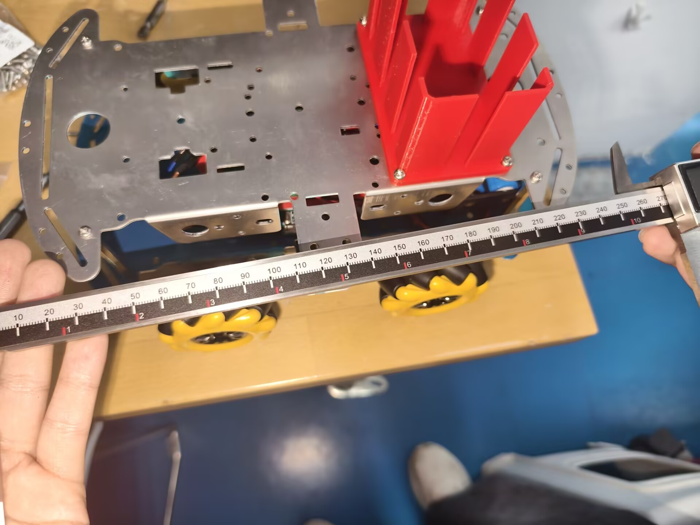
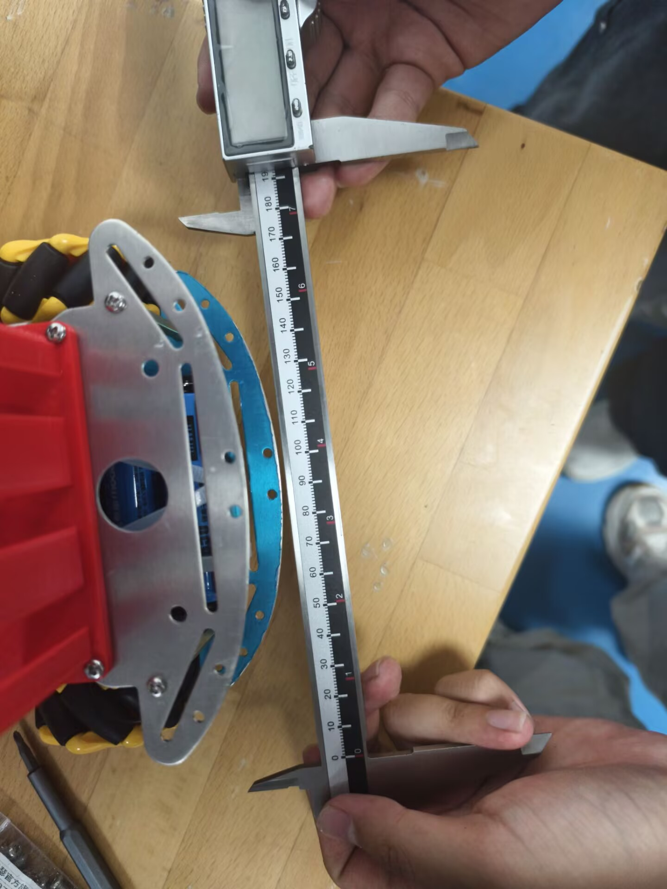
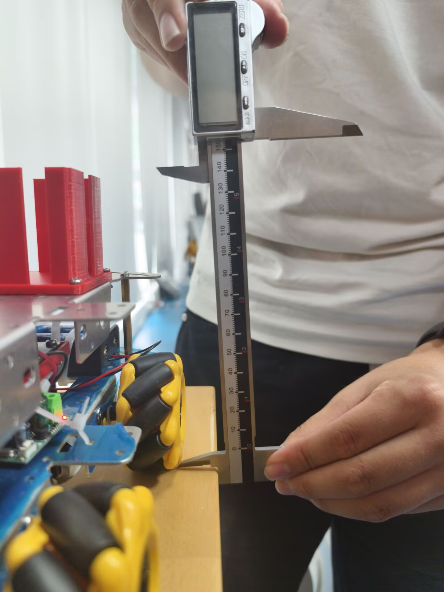

## 外形展示

>此功能将绕车一周，展示一台具有能量单元的完整机器人机体。

此处有一个视频
该车主要由底盘、货箱、机械臂和一些硬件组成。

注： <br>硬件--含【pcb板】【继电器】 <br>机械臂--由于3D打印还没打完，尚未组装完成，但已经设计完了3D图

>以下将展示小车外形功能的设计思路、制作过程和相关知识学习

| 流程 | 知识学习 |	设计思路 | 制作过程|
|--|--|--|--|
|机械臂| 1.fusion360的学习使用、<br>2.机械臂设计的相关视频教程、<br>3.热熔螺母以及它的3D模型打孔规则、<br>4.安放螺母的可操作性方法 |	1.在第一次会议后，根据小车设计相关书籍，我们打算制作“夹子”实现抓取功能<br> 2.之后，机械组研究方块放置，发现有的能量方块被悬挂，被放置在洞里，导致爪只子或铲子是无法抓取到那些能量方块的。于是决定改用“机械臂”实现抓取功能。|	1.跟着教程，在fusion360上设计出了机械臂，<br>2.舵机选用。sg90做关节处不稳定，以及竞赛机器人的机械臂多用MG996R，于是机械组同学重新构思，用MG996R做机械臂的底盘，肩，肘，sg90做机械臂的手腕和手爪。并询问过学长，在学长表示认同后便决定更换。<br>3.尺寸的确定。自己量总归有误差，同时有些零件又不知道要多长。最近在学长的建议下询问淘宝商家，获得了一些尺寸<br>4.加工方案选用上，在培训后了解到用铨洲制造的cnc加工可以增加强度，就想选用CNC加工。但考虑到机器人的重量，零件要自己钻孔和外包的时间问题就还是选用了3D打印的3D建模<br>5.为使用3D打印需求，简化了机械臂设计<br>6.电控组根据机械臂六舵机的特点，选用摇杆控制小车的运动，按键控制各个舵机的运动，并且编写ps2手柄的代码<br>7.【迭代】*由于六舵机实现难度大，存在引脚不够用的问题与较大的操作难度，于是经过小组讨论，决定改成四舵机的机械臂，保留腕部扭动功能，便于适应拾取能量方块的各种场景*<br>8.机械组完成了3d建模，电控完成了代码，并且实现了ps2手柄控制四个舵机转动|
|货架| fusion360的学习使用|1.为了携带方块，于是设计了货架来存储方块。<br>2.同时，为了给后续硬件安装留空，设计了栅栏式外墙 |完成设计，3D打印，使用螺丝把货架固定在底盘上
|底盘| 麦轮与tt马达连接的视频教程|因为底盘尺寸误差大，设计时经过多次测量和计算，依据孔的位置来设计收集装置、机械臂云台之类的固定位置 |1.按照视频教程，通过螺丝螺母把麦轮与tt马达连接在一起了<br>2.  【！迭代！】由于本次赛事场地有上坡，而麦轮会打滑，于是我们决定改用普通轮胎，相应地放弃使用PWM控制电机，改用HAL_GPIO_WritePin，通过简单判断与左右车轮速度差产生的扭矩，实现转向功能 |
|硬件连接|绘制原理图及PCB，焊接演示，基本元件，引脚【电控】 | 电控组先给出引脚示意图，硬件同学根据示意图| 1.电控组先给出引脚示意图<br>2.硬件同学根据示意图进行原理图的绘制，中间经过细致检查，修订原理图，对器件引脚重新进行编号，形成第二版原理图<br>3.之后，联系商家打pcb板<br>4.然后，硬件同学完成pcb板与外设的连接<br>5.针对杜邦线铜丝的容易断裂问题，硬件增加焊接点、缠绕胶带来增强杜邦线的抗扭强度<br>6.由于电池电源线与继电器连接存在问题，导致遥控器无法控制继电器，经过反复排查之后，加固电线、增长铜线露出长度、捆绑铜线，解决了问题，实现了继电器的远程控制。<br>7.由于继电器与铝制底盘接触，发生短路，于是我们选择在底盘部分区域贴上绝缘胶带，解决问题|


##  尺寸规范
>此功能将展示机器人尺寸在规则限制范围之内<br>（展示直尺测量工具的测量结果）







<br>

##  结构稳定性
>该功能展示：机器人从180mm处，以底面朝下的初始姿态自由下落，无零件掉出<br>（需展示直尺等测量工具的测量结果）

视频，请见“附件-结构稳定性.MP4”

车体从直尺68cm处摔落到90cm处，实际摔落高度大于等于22cm。

## 电机运动

>此功能展示电机的转动:相关代码（见下），视频（见附件）

视频，请见“附件-电机运动.MP4”
代码，见下

注：电机运动是通过ps2手柄的摇杆操作，左摇杆控制前后左右移动（含左右平移），右摇杆控制小车的顺逆时针原地旋转，代码写有死区，提高ps2操作的安全性与稳定性。

>joystick.c
```
#include "joystick.h"

static int16_t Joy_Norm(uint8_t raw)

{

int16_t v = (int16_t)raw - 128;

if (v >= 0) return (int16_t)((int32_t)v * 100 / 127);

else return (int16_t)((int32_t)v * 100 / 128);

}

static JoyDir Joy_Classify(int16_t nx, int16_t ny)

{

int16_t ax = nx, ay = ny;

if (ax < 0) ax = (int16_t)(-ax);
if (ay < 0) ay = (int16_t)(-ay);

#if JOY_USE_DIAGONAL

if ((int32_t)ay * 5 < (int32_t)ax * 2)
{
return (nx > 0) ? JOY_E : JOY_W;
}

if ((int32_t)ax * 5 < (int32_t)ay * 2)
{
return (ny > 0) ? JOY_N : JOY_S;
}

if (nx > 0) return (ny > 0) ? JOY_NE : JOY_SE;

else return (ny > 0) ? JOY_NW : JOY_SW;

#else

if (ax > ay)
{
return (nx > 0) ? JOY_E : JOY_W;
}

else
{
return (ny > 0) ? JOY_N : JOY_S;
}

#endif
}

JoyResult Joystick_ReadMove(uint8_t raw_x, uint8_t raw_y)
{

JoyResult r;

int16_t nx, ny;
int16_t ax, ay;

nx = Joy_Norm(raw_x);
ny = (int16_t)(-Joy_Norm(raw_y));
ax = (nx >= 0) ? nx : (int16_t)(-nx);
ay = (ny >= 0) ? ny : (int16_t)(-ny);

if (ax < JOY_DEADZONE && ay < JOY_DEADZONE)
{
r.dir = JOY_CENTER;
r.mag = 0;
return r;
}

r.dir = Joy_Classify(nx, ny);
r.mag = (uint8_t)((ax > ay) ? ax : ay);
return r;
}


void Joystick_ToVector(JoyResult r, int16_t *vx, int16_t *vy)
{
int16_t m = (int16_t)r.mag;
int16_t d = (int16_t)((int32_t)m * 707 / 1000);
switch (r.dir)
{

case JOY_N: *vx = m; *vy = 0; break;
case JOY_S: *vx = -m; *vy = 0; break;
case JOY_E: *vx = 0; *vy = m; break;
case JOY_W: *vx = 0; *vy = -m; break;
case JOY_NE: *vx = d; *vy = d; break;
case JOY_NW: *vx = d; *vy = -d; break;
case JOY_SE: *vx = -d; *vy = d; break;
case JOY_SW: *vx = -d; *vy = -d; break;

default: *vx = 0; *vy = 0; break; /* 中间 → 不动 */
}

}

int16_t Joystick_ReadRotate(uint8_t raw_x)

{
int16_t nx = Joy_Norm(raw_x);

if (nx > -JOY_DEADZONE && nx < JOY_DEADZONE)
{
return 0;
}

return nx;
}
```
<br><br>

>ctrl.c
```
void CTRL_Update(void)

{
PS2_Data d;
JoyResult mv;
int16_t vx, vy, w;
if (PS2_ReadData() == 0)

{
Mecanum_Stop();
return;
}

d = PS2_GetData();
mv = Joystick_ReadMove(d.ljoy_x, d.ljoy_y);
Joystick_ToVector(mv, &vx, &vy);
w = Joystick_ReadRotate(d.rjoy_x);
if (vx == 0 && vy == 0 && w == 0)

{
Mecanum_Stop();
}

else
{
Mecanum_Drive(vx, vy, w);
}

Arm_HandleKeys(d.btn1, d.btn2);

}
```
>drv8833.c
```
/**
 * @file drv8833.c
 * @brief DRV8833 双H桥电机驱动器控制（支持 4 个电机）

 */

#include "drv8833.h"
#include "tim.h"  

#define PWM_ARR 3599
#define MAX_SPEED 100

typedef struct {
    TIM_HandleTypeDef *htim;  
    uint32_t ch_in1;          
    uint32_t ch_in2;           
} MotorMap;

static const MotorMap motor_map[MOTOR_COUNT] = {
    /* 左前：TIM2 CH1(PA0)=IN1, CH2(PA1)=IN2 */
    [MOTOR_LF] = {&htim2, TIM_CHANNEL_1, TIM_CHANNEL_2},
    /* 右前：TIM3 CH1(PA6)=IN1, CH2(PA7)=IN2 */
    [MOTOR_RF] = {&htim3, TIM_CHANNEL_1, TIM_CHANNEL_2},
    /* 左后：TIM2 CH3(PA2)=IN1, CH4(PA3)=IN2 */
    [MOTOR_LB] = {&htim2, TIM_CHANNEL_3, TIM_CHANNEL_4},
    /* 右后：TIM3 CH3(PB0)=IN1, CH4(PB1)=IN2 */
    [MOTOR_RB] = {&htim3, TIM_CHANNEL_3, TIM_CHANNEL_4},
};

static DecayMode currentDecayMode = SLOW_DECAY;

static inline uint32_t __SpeedToCCR(uint8_t speed)
{
    return (uint32_t)speed * PWM_ARR / 100u;
}

void DRV8833_Init(void)
{
    HAL_TIM_PWM_Start(&htim2, TIM_CHANNEL_1);
    HAL_TIM_PWM_Start(&htim2, TIM_CHANNEL_2);
    HAL_TIM_PWM_Start(&htim2, TIM_CHANNEL_3);
    HAL_TIM_PWM_Start(&htim2, TIM_CHANNEL_4);
    HAL_TIM_PWM_Start(&htim3, TIM_CHANNEL_1);
    HAL_TIM_PWM_Start(&htim3, TIM_CHANNEL_2);
    HAL_TIM_PWM_Start(&htim3, TIM_CHANNEL_3);
    HAL_TIM_PWM_Start(&htim3, TIM_CHANNEL_4);

    for (int i = 0; i < MOTOR_COUNT; i++) {
        DRV8833_Coast((MotorID)i);
    }
}

void DRV8833_SetDecayMode(DecayMode mode)
{
    currentDecayMode = mode;
}

void DRV8833_Forward(MotorID id, uint8_t speed)
{
    if (id < 0 || id >= MOTOR_COUNT) return;   
    if (speed > MAX_SPEED) speed = MAX_SPEED;   

    const MotorMap *m = &motor_map[id];
    uint32_t pwm = __SpeedToCCR(speed);

    if (currentDecayMode == FAST_DECAY) {
        __HAL_TIM_SET_COMPARE(m->htim, m->ch_in1, pwm);
        __HAL_TIM_SET_COMPARE(m->htim, m->ch_in2, 0);
    } else {
        __HAL_TIM_SET_COMPARE(m->htim, m->ch_in1, PWM_ARR);
        __HAL_TIM_SET_COMPARE(m->htim, m->ch_in2, PWM_ARR - pwm);
    }
}

void DRV8833_Backward(MotorID id, uint8_t speed)
{
    if (id < 0 || id >= MOTOR_COUNT) return;
    if (speed > MAX_SPEED) speed = MAX_SPEED;

    const MotorMap *m = &motor_map[id];
    uint32_t pwm = __SpeedToCCR(speed);

    if (currentDecayMode == FAST_DECAY) {
        __HAL_TIM_SET_COMPARE(m->htim, m->ch_in1, 0);
        __HAL_TIM_SET_COMPARE(m->htim, m->ch_in2, pwm);
    } else {
        __HAL_TIM_SET_COMPARE(m->htim, m->ch_in1, PWM_ARR - pwm);
        __HAL_TIM_SET_COMPARE(m->htim, m->ch_in2, PWM_ARR);
    }
}

void DRV8833_Brake(MotorID id)
{
    if (id < 0 || id >= MOTOR_COUNT) return;
    const MotorMap *m = &motor_map[id];
    __HAL_TIM_SET_COMPARE(m->htim, m->ch_in1, PWM_ARR);
    __HAL_TIM_SET_COMPARE(m->htim, m->ch_in2, PWM_ARR);
}

void DRV8833_Coast(MotorID id)
{
    if (id < 0 || id >= MOTOR_COUNT) return;
    const MotorMap *m = &motor_map[id];
    __HAL_TIM_SET_COMPARE(m->htim, m->ch_in1, 0);
    __HAL_TIM_SET_COMPARE(m->htim, m->ch_in2, 0);
}
```
<br><br>

##  舵机运动
>此功能展示：同一台机器人能完成至少三个舵机的转动，并确保其可动机构能够在任意非初始状态下，保持相对静止
<br>相关代码（见下），视频（见附件）

视频，请见“附件-舵机运动.MP4”
代码，请见下（代码只给出.c文件）

注：
我们实现了ps2手柄控制4个舵机的转动，一个舵机对应两个按钮（分别控制舵机的顺/逆时针旋转）

此外，对于开发板TIM不够的问题，我们绕过编译器，选择一种简单逻辑写舵机代码：
按下按键，舵机顺/逆时针转动少许角度。由于设置的接收器接收周期较短，则近似于接收器一直在接收信息，那么长按按键就可以实现舵机的一直转动（直到转到180°/0°，被钳位）。人眼也可以观察舵机的位置，不需要编译器来不断精确确认舵机位置。

8个按钮，刚好给4个舵机。
<br>
>servo.c
```
#include "servo.h"
#include "tim.h"

typedef struct

{

uint8_t id;
TIM_HandleTypeDef *htim; 
uint32_t channel; 
uint16_t min_us; 
uint16_t max_us; 
uint16_t pos_us; 
} Servo_Slot;

static Servo_Slot s_slot[SERVO_COUNT] =
{
{ SERVO_ID_BIG1, &htim4, TIM_CHANNEL_1, SERVO_BIG1_MIN_US, SERVO_BIG1_MAX_US, SERVO_INIT_US },

{ SERVO_ID_BIG2, &htim4, TIM_CHANNEL_2, SERVO_BIG2_MIN_US, SERVO_BIG2_MAX_US, SERVO_INIT_US },

{ SERVO_ID_BIG3, &htim4, TIM_CHANNEL_3, SERVO_BIG3_MIN_US, SERVO_BIG3_MAX_US, SERVO_INIT_US },

{ SERVO_ID_SMALL6, &htim1, TIM_CHANNEL_4, SERVO_SMALL6_MIN_US, SERVO_SMALL6_MAX_US, SERVO_INIT_US },

};
static int8_t find_slot(uint8_t id)
{
uint8_t i;
for (i = 0u; i < SERVO_COUNT; i++)
{
if (s_slot[i].id == id)
{
return (int8_t)i;
}
}

return -1;
}

static void write_slot(const Servo_Slot *s)
{
__HAL_TIM_SET_COMPARE(s->htim, s->channel, s->pos_us);
}

void Servo_Init(void)
{
uint8_t i;

for (i = 0u; i < SERVO_COUNT; i++)
{
s_slot[i].pos_us = SERVO_INIT_US;
write_slot(&s_slot[i]);
}  

HAL_TIM_PWM_Start(&htim4, TIM_CHANNEL_1); 
HAL_TIM_PWM_Start(&htim4, TIM_CHANNEL_2); 
HAL_TIM_PWM_Start(&htim4, TIM_CHANNEL_3); 
HAL_TIM_PWM_Start(&htim1, TIM_CHANNEL_4);
}

void Servo_SetPulse(uint8_t id, uint16_t pulse_us)
{
int8_t s = find_slot(id);
if (s < 0)
{
return; 
}

if (pulse_us < s_slot[s].min_us) { pulse_us = s_slot[s].min_us; }
if (pulse_us > s_slot[s].max_us) { pulse_us = s_slot[s].max_us; }
 
s_slot[s].pos_us = pulse_us;

write_slot(&s_slot[s]);

}

uint16_t Servo_GetPulse(uint8_t id)
{
int8_t s = find_slot(id);
if (s < 0)
{
return SERVO_INIT_US;
}

return s_slot[s].pos_us;
}
void Servo_Step(uint8_t id, int8_t dir)
{
int8_t s = find_slot(id);
int32_t v;

if (s < 0)
{
return;
}

v = (int32_t)s_slot[s].pos_us

+ (dir > 0 ? (int32_t)SERVO_STEP_US : -(int32_t)SERVO_STEP_US);


if (v < (int32_t)s_slot[s].min_us) { v = (int32_t)s_slot[s].min_us; }
if (v > (int32_t)s_slot[s].max_us) { v = (int32_t)s_slot[s].max_us; }

s_slot[s].pos_us = (uint16_t)v;

write_slot(&s_slot[s]);
}
```

<br><br>
##  底盘运动
>此功能展示：能使用PS2手柄控制全部车体的水平运动<br>（车体与PS2手柄同时出镜、给出相关代码）

此处应有视频，请见附件“底盘运动.mp4”

此处有代码，包含car.c/h，drv8833.c/h，ctrl.c/h，mecanum.c/h，ps2.c/h由于太长，仅给出.c文件。

同时drv8833.c，ctrl.c见电机运动功能部分
<br><br>
>car.c
```
#include "mecanum.h"

static void Motor_SetSigned(MotorID id, int16_t spd)

{
int16_t abs;

abs = (spd >= 0) ? spd : (int16_t)(-spd);

if (abs < MOTOR_MIN_DUTY)
{
DRV8833_Coast(id);
return;
}

if (abs > MOTOR_MAX_DUTY) abs = MOTOR_MAX_DUTY;

if (spd > 0) DRV8833_Forward(id, (uint8_t)abs);
else DRV8833_Backward(id, (uint8_t)abs);

}

void Mecanum_Drive(int16_t vx, int16_t vy, int16_t w)

{

int32_t lf, rf, lb, rb; 
int32_t maxv;


if (vx > MEC_INPUT_MAX) vx = MEC_INPUT_MAX;
if (vx < -MEC_INPUT_MAX) vx = -MEC_INPUT_MAX;
if (vy > MEC_INPUT_MAX) vy = MEC_INPUT_MAX;
if (vy < -MEC_INPUT_MAX) vy = -MEC_INPUT_MAX;
if (w > MEC_INPUT_MAX) w = MEC_INPUT_MAX;
if (w < -MEC_INPUT_MAX) w = -MEC_INPUT_MAX;

vx = (int16_t)((int32_t)vx * MOTOR_MAX_DUTY / MEC_INPUT_MAX);
vy = (int16_t)((int32_t)vy * MOTOR_MAX_DUTY / MEC_INPUT_MAX);
w = (int16_t)((int32_t)w * MOTOR_MAX_DUTY / MEC_INPUT_MAX);

lf = vx + vy + w;
rf = vx - vy - w;
lb = vx - vy + w;
rb = vx + vy - w;

maxv = 1;

if (lf > maxv) maxv = lf;
if (lf < -maxv) maxv = -lf;
if (rf > maxv) maxv = rf;
if (rf < -maxv) maxv = -rf;
if (lb > maxv) maxv = lb;
if (lb < -maxv) maxv = -lb;
if (rb > maxv) maxv = rb;
if (rb < -maxv) maxv = -rb;

if (maxv > MOTOR_MAX_DUTY)
{
lf = lf * MOTOR_MAX_DUTY / maxv;
rf = rf * MOTOR_MAX_DUTY / maxv;
lb = lb * MOTOR_MAX_DUTY / maxv;
rb = rb * MOTOR_MAX_DUTY / maxv;
}

Motor_SetSigned(MOTOR_LF, (int16_t)lf);
Motor_SetSigned(MOTOR_RF, (int16_t)rf);
Motor_SetSigned(MOTOR_LB, (int16_t)lb);
Motor_SetSigned(MOTOR_RB, (int16_t)rb);
}

void Mecanum_Stop(void)

{
DRV8833_Coast(MOTOR_LF);
DRV8833_Coast(MOTOR_RF);
DRV8833_Coast(MOTOR_LB);
DRV8833_Coast(MOTOR_RB);
}
```
<br><br>
>mecanum.c
```
#include "car.h"

void Car_Forward(void) {
DRV8833_Forward(MOTOR_LF, CAR_SPEED);

DRV8833_Forward(MOTOR_RF, CAR_SPEED);

DRV8833_Forward(MOTOR_LB, CAR_SPEED);

DRV8833_Forward(MOTOR_RB, CAR_SPEED);

}

void Car_Backward(void) { 
DRV8833_Backward(MOTOR_LF, CAR_SPEED);

DRV8833_Backward(MOTOR_RF, CAR_SPEED);

DRV8833_Backward(MOTOR_LB, CAR_SPEED);

DRV8833_Backward(MOTOR_RB, CAR_SPEED);

}

void Car_SlideRight(void) { 

DRV8833_Forward(MOTOR_LF, CAR_SPEED);

DRV8833_Backward(MOTOR_RF, CAR_SPEED);

DRV8833_Backward(MOTOR_LB, CAR_SPEED);

DRV8833_Forward(MOTOR_RB, CAR_SPEED);

}

void Car_SlideLeft(void) { 

DRV8833_Backward(MOTOR_LF, CAR_SPEED);

DRV8833_Forward(MOTOR_RF, CAR_SPEED);

DRV8833_Forward(MOTOR_LB, CAR_SPEED);

DRV8833_Backward(MOTOR_RB, CAR_SPEED);

}


void Car_RotateCW(void) { 

DRV8833_Forward(MOTOR_LF, CAR_SPEED);

DRV8833_Backward(MOTOR_RF, CAR_SPEED);

DRV8833_Forward(MOTOR_LB, CAR_SPEED);

DRV8833_Backward(MOTOR_RB, CAR_SPEED);

}

void Car_RotateCCW(void) { 

DRV8833_Backward(MOTOR_LF, CAR_SPEED);

DRV8833_Forward(MOTOR_RF, CAR_SPEED);

DRV8833_Backward(MOTOR_LB, CAR_SPEED);

DRV8833_Forward(MOTOR_RB, CAR_SPEED);

} 

void Car_Stop(void) { 

DRV8833_Coast(MOTOR_LF);

DRV8833_Coast(MOTOR_RF);

DRV8833_Coast(MOTOR_LB);

DRV8833_Coast(MOTOR_RB);

}
```
<br>
<br>

>ps2.c
```
#include "ps2.h"
#include "main.h" 

#define PS2_CS_PORT     GPIOB
#define PS2_CS_PIN      GPIO_PIN_13

#define PS2_CLK_PORT    GPIOB
#define PS2_CLK_PIN     GPIO_PIN_14

#define PS2_CMD_PORT    GPIOB
#define PS2_CMD_PIN     GPIO_PIN_12

#define PS2_DAT_PORT    GPIOA
#define PS2_DAT_PIN     GPIO_PIN_12

#define CS_H()      HAL_GPIO_WritePin(PS2_CS_PORT,  PS2_CS_PIN,  GPIO_PIN_SET)
#define CS_L()      HAL_GPIO_WritePin(PS2_CS_PORT,  PS2_CS_PIN,  GPIO_PIN_RESET)
#define CLK_H()     HAL_GPIO_WritePin(PS2_CLK_PORT, PS2_CLK_PIN, GPIO_PIN_SET)
#define CLK_L()     HAL_GPIO_WritePin(PS2_CLK_PORT, PS2_CLK_PIN, GPIO_PIN_RESET)
#define CMD_H()     HAL_GPIO_WritePin(PS2_CMD_PORT, PS2_CMD_PIN, GPIO_PIN_SET)
#define CMD_L()     HAL_GPIO_WritePin(PS2_CMD_PORT, PS2_CMD_PIN, GPIO_PIN_RESET)
#define DAT_READ()  HAL_GPIO_ReadPin(PS2_DAT_PORT, PS2_DAT_PIN)
#define PS2_CLK_DELAY_US    10u
#define PS2_FRAME_DELAY_US  5u

static PS2_Data g_ps2;            
static uint8_t  g_raw[9];          
static const uint8_t PS2_CMD_POLL[9] =
    { 0x01, 0x42, 0x00, 0x00, 0x00, 0x00, 0x00, 0x00, 0x00 };
static void PS2_DWT_Init(void)
{
    CoreDebug->DEMCR |= CoreDebug_DEMCR_TRCENA_Msk;   
    DWT->CYCCNT = 0u;                                 
    DWT->CTRL  |= DWT_CTRL_CYCCNTENA_Msk;
    }

static void PS2_DelayUs(uint32_t us)
{
    uint32_t start = DWT->CYCCNT;
    uint32_t ticks = us * (SystemCoreClock / 1000000u);   

    while ((DWT->CYCCNT - start) < ticks)
    {}
}


static uint8_t PS2_TransferByte(uint8_t tx)
{
    uint8_t rx = 0u;
    uint8_t i;

    for (i = 0u; i < 8u; i++)
    {
        if ((tx & 0x01u) != 0u) { CMD_H(); } else { CMD_L(); }

        CLK_L();
        PS2_DelayUs(PS2_CLK_DELAY_US);
        CLK_H();
        PS2_DelayUs(PS2_CLK_DELAY_US);

        if (DAT_READ() == GPIO_PIN_SET)
        {
            rx |= (uint8_t)(1u << i);
        }

        tx >>= 1;
    }

    return rx;
}

static void PS2_Exchange(const uint8_t cmd[9], uint8_t recv[9])
{
    uint8_t i;

    CS_L();
    PS2_DelayUs(PS2_FRAME_DELAY_US);

    for (i = 0u; i < 9u; i++)
    {
        recv[i] = PS2_TransferByte(cmd[i]);
        PS2_DelayUs(PS2_FRAME_DELAY_US);
    }

    CS_H();
    PS2_DelayUs(PS2_FRAME_DELAY_US);
}

void PS2_Init(void)
{
   
    CS_H();
    CLK_H();
    CMD_H();

    PS2_DWT_Init();

    HAL_Delay(50u);

    {
        static const uint8_t cfg_enter[9]  = {0x01,0x43,0x00,0x01,0x00,0x00,0x00,0x00,0x00};
        static const uint8_t cfg_analog[9] = {0x01,0x44,0x00,0x01,0x00,0x00,0x00,0x00,0x00};
        static const uint8_t cfg_exit[9]   = {0x01,0x43,0x00,0x00,0x5A,0x5A,0x5A,0x5A,0x5A};
        uint8_t tmp[9];

        PS2_Exchange(cfg_enter,  tmp);  HAL_Delay(10u);
        PS2_Exchange(cfg_analog, tmp);  HAL_Delay(10u);
        PS2_Exchange(cfg_exit,   tmp);  HAL_Delay(10u);
    }

    g_ps2.mode = 0u;  g_ps2.btn1 = 0u;  g_ps2.btn2 = 0u;
    g_ps2.rjoy_x = 0u; g_ps2.rjoy_y = 0u;
    g_ps2.ljoy_x = 0u; g_ps2.ljoy_y = 0u;
    g_ps2.ok = 0u;

    {
        uint8_t tmp[9];
        PS2_Exchange(PS2_CMD_POLL, tmp);
    }
}

uint8_t PS2_ReadData(void)
{

    PS2_Exchange(PS2_CMD_POLL, g_raw);
    if (g_raw[2] != 0x5A)
    {
        g_ps2.ok = 0u;
        return 0u;                
    }

    g_ps2.mode   = g_raw[1];        
    g_ps2.btn1   = g_raw[3];        
    g_ps2.btn2   = g_raw[4];        
    g_ps2.rjoy_x = g_raw[5];        
    g_ps2.rjoy_y = g_raw[6];       
    g_ps2.ljoy_x = g_raw[7];        
    g_ps2.ljoy_y = g_raw[8];        
    g_ps2.ok     = 1u;

    return 1u;
}

PS2_Data PS2_GetData(void)
{
    return g_ps2;
}

const uint8_t *PS2_GetRaw(void)
{
    return g_raw;                   
}
```

##  方块携带
>此功能展示：机器人可以自主使在地面静止的一块方块由非携带状态转变为携带状态后在保持其携带状态下，使至少一
块在地面静止的方块由非携带状态转变为携带状态
结构稳定性

<br>
<br>

##  规划&现有采购单

>此功能展示战队分工、时间规划、现有采购单

<br>
一、战队分工

| 姓名 | 项目分工 |	兼任|
|--|--|--|
| 蒋易佐 | 电控 |队长
|	赵思茜|电控	|
|吉俊豪 | 机械|
|刘纶杰 |机械 |
|	唐智涵|硬件 |

注：排名不分先后，操作手暂时未定……………
<br>
___
二、时间规划

| 时间 | 事件|	
|--|--|
|9.12-9.27|确定项目分工、初步学习各自分工的专业知识
| 9.27 | 第一次会议<br>【确定物资采买、初步设计抓取功能】
|	9.28-10.9|完成底盘制作、机械臂设计迭代、深入学习分工专业知识|
|10.10 | 第二次会议	<br>【机器人整体设计、零件新增、预算讨论、后续时间安排】|
|10.11 |完成引脚相关工作、绘制原理图、机械臂迭代|
|10.12|完成底盘增设的设计|
|10.15|完成麦轮的代码|
|10.16|完成pcb板的焊接、完成ps2的代码|
|10.17|一起联合调试，完成了底盘与pcb的固定，电机转动的实现，ps2手柄的配对，【！迭代！】*我们觉得修改机械臂的舵机数量，从而适配开发板、降低操作手的操作难度，实现手柄控制小车运动的功能*|
|10.18|弄完了舵机代码，测试了手柄的锁定功能；加固了螺丝；继电器与铝制车底盘接触短路，增贴了绝缘胶带，解决了问题；准备完了日志相关素材|
---
三、现有采购单
|物品|数量|单价|运费
|-|-|-|-|
304盘头十字螺丝M3*45 50粒|1|2.98|0
304盘头十字螺丝M3*6 100粒|1|0.9|0
304盘头十字螺丝M3*12 100粒|1|4.05|0
304盘头十字螺丝M2*4 50套|1|3.66|0
304盘头十字螺M3*10 100个|1|3.71|0
304盘头十字螺丝M4*8 50套|1|6.43|0
304盘头十字螺丝M4*25 20套|1|3.97|0
304盘头十字螺丝2*6 50套|1|3.74|0
304盘头十字螺丝M4*45 20套|1|5.72|0
304盘头十字螺丝M4*10 50套|1|6.84|0
304盘头十字螺丝M2*4 50套|1|1.66|0
轴承MR83W2.5 3*8*2.5开式|6|2.3|0
深沟球超薄轴承|2|20.14|0
25T舵机通用圆盘 金属银色|7|2.24|0
21T金属盘|4|6|8
4轮金属底盘折弯板|2|11.2|3
MG996R舵机|6|10.2|2.2
螺丝胶放松紧固厌氧胶水 高强度耐油性|1|1|0
米乐奇橡胶密封条|1|1.95|6
c8t6开发板|4|均价10.4|0
端子|2|均价0.15|3
2P公头|1|2.41|0
18650锂电池|4|4.5|0
降压模块|2|2.5|0
继电器|2|13.8|0
杜邦线|3|均价2.4|0
面包板|2|3.5|0
电池盒|2|1.98|0
drv8833驱动模块|4|2.17|0
SG90舵机|4|5.9|0
MG995舵机|1|14.5|0
锂电池充电器|1|8.6|0
ST-LINK|1|10.16|0
小车底盘|2|11.2|3
麦轮(一套4个)|2|36.5|3.8
锁定款ps2手柄|2|45|0
tt马达|8|2.83|0
